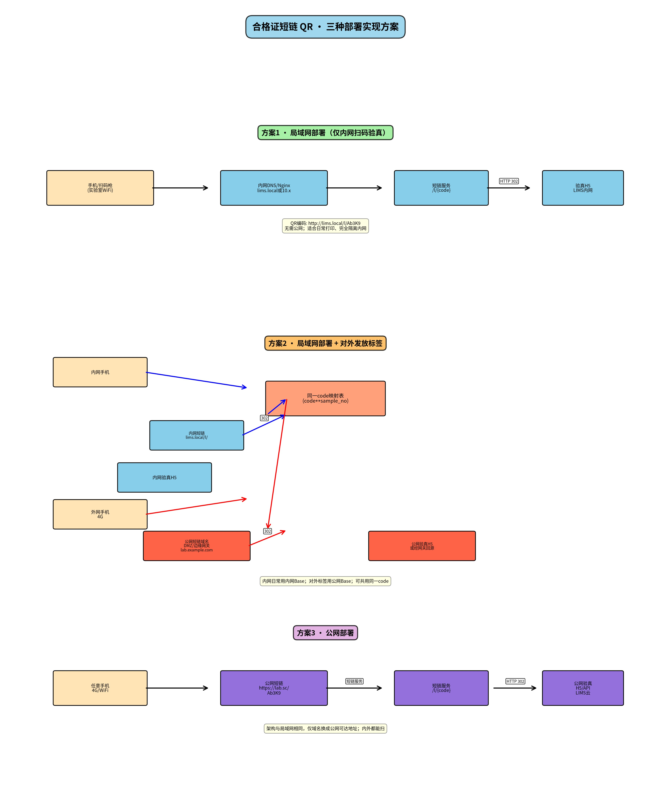

# 合格证短链 QR · 三种部署实现方案

> 文档版本：v2.0  
> 适用项目：智慧实验室 LIMS · 标签打印 / 合格证验真  
> 关联原型：`js/short-link-qr.js`、`cert-verify.html`、`label-print.html`、`cert-print-*.html`  
> 架构图：

---

##  选方案

| 你的场景 | 选哪套 |
|----------|--------|
| 只在实验室内扫码验真，外网客户**不需要**扫合格证 | **方案 1 · 纯局域网** |
| LIMS 仍部署在内网，但合格证会**对外发放**，客户要用 4G 扫码 | **方案 2 · 局域网 + 对外发放** |
| LIMS / 验真本身就部署在公网或云上，内外都能访问 | **方案 3 · 公网部署** |

三套方案的**业务链路相同**，差别只在「短链域名放哪、谁能访问到」：

```
扫码 → 短链 URL → 查表（code ↔ sample_no）→ HTTP 302 → 验真 H5
```

---

## 1. 为什么要用短链（共性背景）

### 1.1 原方案问题

若 QR 直接编码完整验真 URL（常含试样号、token），字符数往往 60～200+，码点密，小尺寸合格证上微信/支付宝识别率低。

### 1.2 短链做法

QR **只编码短 URL**（约 15～30 字符），短链服务查表后 **302** 到验真页。缩短的是「码内字符串」，与公网/内网无关。

| 类型 | 示例 |
|------|------|
| 公网短链 | `https://lab.sc/Ab3K9` |
| 内网短链 | `http://lims.local/l/Ab3K9` 或 `http://10.x.x.x/l/Ab3K9` |

### 1.3 验真规则（三套方案共用）

**有效**（「短链有效，验真通过」）需同时：

1. `code` 存在  
2. 委托处于**报告签发及后续**  
3. 当前日期 ≤ 再检日期  
4. 状态为 `valid`（未作废）

**无效**：短链不存在 / 过再检日期 / 流程回退作废 。

**生成时机**：报告签发后续生成；同试样复用；回退至签发前自动 `revoked`。

### 1.4 映射表（三套方案共用）

| 字段 | 说明 |
|------|------|
| `code` | 5～8 位短码，写入 QR |
| `sample_no` | 试样编号 |
| `entrust_no` | 委托编号 |
| `status` | valid / expired / revoked |
| `reinspect_date` | 再检日期 |
| `long_url` | 302 目标验真地址 |
| `created_at` | 创建时间 |

---

## 2. 方案 1 · 局域网部署（仅内网扫码验真）

### 2.1 适用场景

- 合格证主要在**实验室内部**流转、验收、抽查  
- **外网客户不需要**扫码打开验真 H5  
- 机房可为**完全隔离内网**（无公网出口也可）

### 2.2 实现拓扑

```
手机/扫码枪（实验室 WiFi）
        │ 扫码
        ▼
内网 DNS / Nginx（lims.local 或 10.x）
        │ /l/{code}
        ▼
短链服务（可嵌入 LIMS 网关）
        │ HTTP 302
        ▼
验真 H5（LIMS 内网）
```

### 2.3 需求描述详情

| 项 | 要求 |
|----|------|
| QR 编码内容 | 仅内网短链，如 `http://lims.local/l/Ab3K9` |
| 短链 Base | 配置项，如 `SHORT_LINK_BASE=http://lims.local/l/` |
| 网络前提 | 扫码手机/扫码枪与 LIMS **同一局域网**（实验室 WiFi） |
| 公网能力 | **不需要**公网域名、DMZ、外网验真入口 |
| DNS | **优先内网域名**，避免 IP 变更导致已打印标签失效 |
| HTTPS | 内网可选；纯 HTTP 通常可接受；微信扫 IP 偶有限制，域名更稳 |
| QR 生成 | **本地库**生成，不依赖公网 CDN |
| 短链服务位置 | 与 LIMS 同机或内网 API 网关即可，不必独立产品 |

### 2.4 Nginx 示例（内网）

```nginx
location ~ ^/l/([A-Za-z0-9]+)$ {
    proxy_pass http://127.0.0.1:8080/api/shortlink/redirect?code=$1;
}
location /verify/ {
    proxy_pass http://127.0.0.1:8080/verify/;
}
```

### 2.5 能力边界

| 扫码方 | 能否验真 |
|--------|----------|
| 实验室 WiFi / 同网段 | ✅ |
| 扫码枪直连内网 | ✅ |
| 外网 4G（无 VPN） | ❌ 访问不到内网 |
| 外网 + VPN 入内网 | ✅（等同内网） |

### 2.6 本方案实施清单

- [ ] 确定内网短链 Base（域名优先，如 `http://lims.local/l/`）  
- [ ] 映射表 + 作废策略（含流程回退）  
- [ ] `/l/{code}` 302 接口 + 验真 H5  
- [ ] 打印模块：签发后续才发码；QR 写入内网 Base + code  
- [ ] 本地 QR 生成；Nginx/内网 DNS  
- [ ] 真机微信/支付宝在**实验室 WiFi**下验收  

---

## 3. 方案 2 · 局域网部署 + 对外发放标签（内外都能扫）

### 3.1 适用场景

- LIMS / 主数据仍在**内网**  
- 日常打印、实验室抽查走内网（同方案 1）  
- 部分合格证要**发给外部客户**，对方用 4G/公网 WiFi 扫码验真  

### 3.2 实现拓扑（双路径，共用一张映射表）

```
                    ┌─ 内网路径 ─────────────────────────────┐
内网手机(WiFi) → lims.local/l/{code} → 302 → 内网验真 H5
                    │                                         │
                    │         ┌──────────────────┐            │
                    └────────►│ 同一 code 映射表  │◄───────────┘
                              │ code ↔ sample_no │
                    ┌────────►└──────────────────┘◄───────────┐
                    │                                         │
外网手机(4G) → 公网边缘/DMZ lab.example.com/l/{code}          │
                    │              302 → 公网验真 H5           │
                    └─ 外网路径 ──（可读内网验真 API）─────────┘
```

### 3.3 需求描述详情

| 项 | 要求 |
|----|------|
| 内网日常打印 | QR 使用**内网 Base**（同方案 1） |
| 对外发放标签 | QR 使用**公网 Base**（如 `https://lab.example.com/l/`） |
| code 策略 | **同一 `code` 映射表**；内外入口查同一条记录，避免两套码 |
| 公网边缘 | 必须有：公网短链域名 + DMZ/网关；外网**不能**直连内网 IP |
| 公网验真 H5 | 部署在边缘或经网关回源；只读验真所需公开字段，不暴露完整内网 |
| 打印策略 | 按「是否对外发放」选择写入哪套 Base；或打印前可切换 Base |
| 配置项建议 | `SHORT_LINK_BASE_INTERNAL` + `SHORT_LINK_BASE_PUBLIC` |
| 安全 | 公网仅暴露短链跳转 + 验真只读接口；短码随机、可作废、可审计 |

### 3.4 内外路径对照

| | 内网日常 | 对外发放 |
|--|----------|----------|
| 扫码网络 | 实验室 WiFi | 客户 4G/公网 |
| QR 内 URL | `http://lims.local/l/Ab3K9` | `https://lab.example.com/l/Ab3K9` |
| 302 目标 | 内网验真 H5 | 公网验真 H5（读内网 API） |
| 映射表 | 同一 `code` | 同一 `code` |

### 3.5 能力边界

- 内网扫码：✅（与方案 1 相同）  
- 外网 4G 扫**公网 Base** 的标签：✅  
- 外网扫**内网 Base** 的标签：❌（仍访问不到内网）  
- 完全隔离且**又要**对外扫码：不可只靠方案 1，必须上本方案的公网边缘（或改为方案 3）

### 3.6 本方案实施清单

- [ ] 完成方案 1 的内网短链与验真  
- [ ] 申请/配置公网短链域名与 DMZ/边缘网关  
- [ ] 公网 `/l/{code}` 查**同一**映射表并 302  
- [ ] 公网验真 H5 + 只读验真 API（回源内网）  
- [ ] 打印区分「对内 / 对外」Base  
- [ ] 分别用实验室 WiFi 与外网 4G 真机验收  

---

## 4. 方案 3 · 公网部署（任意网络可扫）

### 4.1 适用场景

- LIMS 或验真服务本身部署在**公网 / 云**  
- 希望实验室内外、客户现场**统一一套短链域名**  
- 不依赖「手机必须连实验室 WiFi」

### 4.2 实现拓扑

```
任意手机（4G / WiFi）
        │ 扫码
        ▼
公网短链（https://lab.sc/Ab3K9）
        │
        ▼
短链服务（查表 /l/{code}）
        │ HTTP 302
        ▼
公网验真 H5 / API（LIMS 云或公网）
```

### 4.3 需求描述详情

| 项 | 要求 |
|----|------|
| 架构 | 与方案 1 **相同**（短链 → 302 → 验真 H5），仅域名改为公网可达 |
| QR 编码内容 | 如 `https://lab.sc/Ab3K9` |
| 短链 Base | `SHORT_LINK_BASE=https://lab.sc/`（或带路径的公网前缀） |
| 网络前提 | 扫码设备能上公网即可；实验室内网用户一般也能扫 |
| HTTPS | **建议强制 HTTPS**（公网微信/支付宝更友好） |
| 与隔离网关系 | 纯隔离、无公网出口的机房**不能单独依赖本方案**访问公网短链；隔离场景用方案 1，或方案 2 做边缘 |

### 4.4 与方案 1 / 2 的差异（一句话）

- 相对方案 1：换公网域名，内外都能扫；不再「纯内网即可」。  
- 相对方案 2：通常**只需一套 Base**，不必维护「对内打印 / 对外发放」两套 QR 前缀（除非仍要内网专域）。

### 4.5 本方案实施清单

- [ ] 确定公网短链域名与 HTTPS 证书  
- [ ] 映射表 + `/l/{code}` 302 + 公网验真 H5  
- [ ] 打印写入公网 Base + code  
- [ ] 本地或服务端 QR 生成  
- [ ] 外网 4G + 实验室网络双端真机验收  

---

## 5. 三套方案对照总表

| 维度 | 方案 1 纯局域网 | 方案 2 局域网+对外 | 方案 3 公网 |
|------|-----------------|-------------------|-------------|
| LIMS 主部署 | 内网 | 内网 | 公网/云 |
| QR Base | 仅内网 | 内网 + 公网两套 | 仅公网（常见） |
| 实验室内扫码 | ✅ | ✅ | ✅ |
| 外网 4G 扫码 | ❌ | ✅（须打公网 Base 标签） | ✅ |
| 完全隔离内网 | ✅ 纯内网即可 | 内网侧可隔离，对外依赖边缘 | 需公网可达 |
| 映射表 | 1 套 | 1 套（共用） | 1 套 |
| 复杂度 | 低 | 中（多边缘与双 Base） | 低～中 |

---

## 6. 与原型的对应关系

| 原型文件 | 生产对应 |
|----------|----------|
| `js/short-link-qr.js` | 短链生成 + 映射表 |
| `cert-verify.html` | 验真 H5 |
| `js/flow-stages.js` | 签发后续才发码 / 门禁 |
| `label-print.html` / `cert-print-*.html` | 打印时写入 `SHORT_LINK_BASE + code` |
| 系统参数 / 环境变量 | `SHORT_LINK_BASE`（方案 2 可拆 internal/public） |

```javascript
// 方案 1
var SHORT_LINK_BASE = 'http://lims.local/l/';
// 方案 3
var SHORT_LINK_BASE = 'https://lab.sc/';
// 方案 2：按是否对外发放选择
// SHORT_LINK_BASE_INTERNAL / SHORT_LINK_BASE_PUBLIC
```

### 原型演示码

| code | 结果 |
|------|------|
| `Ab3K9` | 有效 |
| `Ex1p1` | 过期 |
| `Rv0k1` | 回退作废 |
| 任意不存在 | 无效 |

演示：`cert-verify.html?code=Ab3K9`

---

## 7. 常见问题 FAQ

**Q1：局域网不用短链、直接编内网完整 URL 可以吗？**  
可以，但 QR 更长、识别率更低。短链在局域网同样有价值。

**Q2：短链服务必须独立部署吗？**  
不必。可为 LIMS 后端一个模块（Controller + 映射表）。

**Q3：已打印标签后服务器 IP 变了？**  
若 QR 写的是 IP 会失效。应用内网/公网**域名**，只改 DNS。

**Q4：微信扫内网 QR 打不开？**  
查：是否同 WiFi、是否用了 IP、是否被非 HTTPS 拦截。优先内网域名。

**Q5：方案 2 内外必须用不同 code 吗？**  
不必须。推荐**同一 code**，仅 Base 不同，便于运维与作废联动。

**Q6：扫码枪要特殊开发吗？**  
一般不需要；能打开 HTTP(S) URL 即可。

---

## 8. 总结

1. 短链是**编码优化**：码更短、更好扫；公网/内网都能用。  
2. **方案 1**：只内网验真 → 内网 Base，纯隔离可用。  
3. **方案 2**：内网 LIMS + 对外发放 → 双 Base、公网边缘、**共用映射表**。  
4. **方案 3**：整体公网 → 单公网 Base，架构同方案 1。  
5. 业务规则不变：签发后续发码、复用、回退作废、验真四条件。

建议生产默认：**域名 + `/l/{code}` + 本地 QR 生成**，再按上表选择 1 / 2 / 3。
